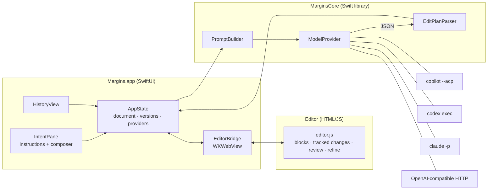

# 4. Architecture



## Package layout

| Target | What |
|---|---|
| `MarginsCore` | UI-free library: `EditPlan` + schema + tolerant parser, `PromptBuilder`, the document model (`MarginsDocument`, `Intent`, `Version`), and all providers. |
| `Margins` | The SwiftUI app plus the `Resources/Editor` web editor. |
| `MarginsCLI` (`margins-cli`) | Command-line access to the providers: `models`, `edit`. Handy for checking providers without the GUI. |
| `MarginsSelfTest` | Self-test executable for the core logic (stands in for XCTest when only the Command Line Tools are installed). |

## The block model

The document is HTML. Every **top-level block** (`p`, `h1–h3`, `ul`, `ol`, `blockquote`, `pre`, `table`…) carries a stable id, `data-bid="bN"`. The agent sees the document as a list of `{id, html}` blocks plus the ids of any blocks the user has selected (`focus`), and answers with block-level edits. Block granularity keeps the agent's output small and makes it easy to apply edits and show them as tracked changes. Finer, word-level diffing *inside* a replaced block is on the roadmap.

## Tracked changes in the DOM

A pending change is a wrapper element:

```html
<div class="chg" data-cid="c7" data-step="3" data-bid="b4" data-kind="replace">
  <del contenteditable="false"><p data-bid="b4">old text…</p></del>
  <ins><p>new text…</p></ins>
  <span class="tools">✓ ✕ 💬</span>
</div>
```

- **Accept** unwraps `<ins>` (its first block inherits the original `data-bid`) and drops `<del>`. **Reject** does the reverse.
- If a later instruction edits a block that already has a pending change, the `<ins>` is updated, but the original `<del>` is kept, so rejecting still restores what you actually had.
- The first draft of an empty document is applied directly, with no tracked changes.
- `normalize()` keeps the DOM honest after user edits: it wraps stray text in `<p>`, turns `contenteditable` `<div>`s into `<p>`, and de-duplicates ids cloned by pressing Enter.

## Swift ⇄ editor bridge

`EditorBridge` loads `editor.html` from the bundled resources and talks to `window.margins`:

| Swift → JS | JS → Swift (`webkit.messageHandlers.margins`) |
|---|---|
| `load(html)`, `html()`, `getBlocks()` | `ready` |
| `applyEdits(step, edits, direct)` | `pending {total, byStep, selected}` |
| `accept/reject({all\|step\|selected\|cid})` | `edited {sections, html}` (debounced, user typing) |
| `refineContext(cid)`, `applyRefinement(cid, html, n)` | `reviewed {accepted, rejected, sections, html}` |
| `highlightStep`, `revealStep`, `preview`, `endPreview` | `refine {cid, step, instruction}` |
| `insertImage(src, alt)`, `editLink()` | `openURL {url}` |
| `setThreads(list)`, `openThread(id)` | `ask {thread, quote, focus, anchor, message}`, `stop {step}` |

Two more channels serve images. `webkit.messageHandlers.assets` is a reply handler: pasted or dropped image bytes go in as `{mime, data}` and the stored asset's URL comes back. A `WKURLSchemeHandler` for `margins-asset://` serves those assets back to the page.

## Flow of one instruction

1. The composer submits; `AppState` appends an `Intent` (status *working*).
   - `fetchSources` fetches material Margins can get more reliably than an agent: for every YouTube link in the instruction, `YouTube.fetch` (in `MarginsCore`) reads the watch page, calls the innertube `player` endpoint, picks a caption track (human captions in your language first, then auto-captions) and turns the caption XML into paragraphs. Each fetch shows as a step on the card. The result goes into the prompt as a `SOURCE MATERIAL` section (capped at 150k characters per source). A failed fetch is recorded on the step, and the agent still runs.
2. `editor.getBlocks()` → blocks + focus; `PromptBuilder.editPrompt` builds the prompt.
3. The active `ModelProvider` returns text; `EditPlanParser` extracts the plan, with one retry on invalid JSON.
4. `editor.applyEdits(step, edits, direct: isEmptyDoc)` renders the changes; the intent gets its summary/notes and status *N pending* or *applied*.
5. A `Version` (author *agent*, slug from the plan) is snapshotted, and the document autosaves.
6. Review or user edits produce further versions (author *review* / *you*) with generated slugs.

## Inline discussion threads

Selecting text in the editor shows an **Ask** chip (⌘J does the same). It opens a thread popover anchored to the selection; the quoted range is highlighted with the CSS Custom Highlight API, so the DOM isn't touched.

1. Sending a message posts `ask {thread, quote, focus, anchor, message}`. `thread` is a UUID made in JS, `focus` lists the blocks the selection touched, and `anchor` is the first of them.
2. `AppState.discuss` appends an ordinary instruction `Intent` carrying `thread`, `quote`, `focus` and `anchor`, so it gets a step number, a card, agent tools, Stop and permission prompts like any instruction. Later messages in the thread reuse the first message's quote and focus.
3. `PromptBuilder.discussPrompt` sends the document, the `SELECTED PASSAGE` and its blocks, earlier turns of this thread (message, reply, what was edited) and the new message. The edit plan has a `reply` field. A question gets a reply and no edits. A change request gets edits, limited to the selected blocks unless clearly needed, plus a one-sentence reply.
4. Edits apply as tracked changes for that message's step, so review, refine and history work unchanged. The intent stores `reply` and ends as *N pending* if anything changed, otherwise *answered* (`done`).
5. `AppState` pushes the threads (grouped from intents, with live status, current activity, pending counts and permission waits) to `setThreads`. Pushes are coalesced and skipped when nothing changed. The editor redraws the open thread and the 💬 margin markers. A marker sits beside the thread's anchor block and reopens the thread; the quote is found again by whitespace-insensitive text search, because the original `Range` doesn't survive the block being rewritten.

## Agent runs

When the tool policy isn't *Off*, `AppState.submit` attaches an `AgentContext` (in `MarginsCore/Providers/Agent.swift`) to the `GenerationRequest`:

- `policy`: `off | research | full` (`AgentToolPolicy`).
- `workspace`: the document's `projectFolder` if set (and it exists), otherwise the per-document directory, keyed by `MarginsDocument.id`.
- `project`: true when `workspace` is the author's project. `PromptBuilder.system` then says the agent may implement, fix, build and test there (not commit or push unless asked) and report what it did in `reply`. `discussPrompt` adds the same "work outside the document" case.
- `onEvent(AgentEvent)`: `.step(AgentStep)` for each tool call or update (kind, title, detail such as the command or URL, and status running/done/failed/denied) and `.thought(String)` for narration.
- `askPermission(PermissionRequest) async -> PermissionDecision`: called only when `autoDecision(for:)` returns nil, i.e. a non-read-only tool under *Research*. `AppState` stores a `PermissionAsk` for the card, `PermissionPrompt` renders it, and the continuation resumes on Allow / Allow all / Deny.

`PromptBuilder.system(tools:)` adds an agent preamble: which tools are allowed, the workspace path, "cite sources, don't invent facts", and "your final message must be only the edit-plan JSON".

Provider adapters translate their native streams into `AgentEvent`s:

| Provider | Source of events | Permission |
|---|---|---|
| Copilot | ACP `session/update` (`tool_call`, `tool_call_update`, `agent_thought_chunk`, narration flushed when a tool call starts) | `session/request_permission` → `ACPProvider.outcome(decision, options)` |
| Codex | `codex exec --json` lines (`item.started` / `item.completed`) via `CodexProvider.events` | none (sandbox) |
| Claude | `stream-json` lines (`tool_use`, `tool_result`, `thinking`) via `ClaudeProvider.events` | none (allow-list) |

**Changed files.** When `project` is set, `AppState` takes a `ProjectChanges.snapshot` (`git status --porcelain -z -uall` plus each listed path's modification time) off the main thread before and after the run, and stores the difference on the intent as `files`. So pre-existing uncommitted changes aren't attributed to the agent unless it touched them again. Non-git folders give no list. `IntentCard` shows "Changed N files" (click to open), and the thread payload carries `files` for the bubble.

`ProcessRunner.run(onLine:)` streams subprocess stdout line by line. Each run's `Task` is kept in `AppState.running[step]`, so Stop / ⌘. can cancel it. Steps are saved on the `Intent` (`steps`), so a finished card can still show "Used 6 tools · web, shell". The live thought and pending permission asks are transient.

## File format

`*.margins` is JSON:

```json
{ "format": 1, "id": "…uuid…", "html": "…", "nextStep": 4,
  "intents":  [{ "id": "…", "step": 1, "kind": "instruction", "text": "…", "status": "done", "summary": "…",
                 "notes": [], "provider": "GitHub Copilot", "refinements": 0, "createdAt": "…",
                 "steps": [{ "id": "…", "kind": "fetch", "title": "Fetching web content", "detail": "https://…", "status": "done" }],
                 "thread": "…uuid…", "quote": "selected text", "focus": ["b4"], "anchor": "b4", "reply": "…", "files": ["src/app.swift"] }],
  "versions": [{ "id": "…", "number": 1, "slug": "draft rate limiting design note", "author": "agent",
                 "detail": "<instruction>", "html": "…", "createdAt": "…" }],
  "assets":   { "3f9a…": { "mime": "image/svg+xml", "data": "<base64>" } },
  "projectFolder": "/Users/me/src/app" }
```

`assets`, `id`, `steps`, `projectFolder`, `files` and the thread fields (`thread`, `quote`, `focus`, `anchor`, `reply`, present only on inline-discussion messages) are optional, so older files still open. A missing `id` is assigned on open and saved.

Pending changes are saved as part of `html`, so you can quit mid-review and pick it up later.

### Images and diagrams

Images live once in `assets`, keyed by the first 128 bits of their SHA-256. The HTML, including every version snapshot, refers to them as `.<ext>">`, so history does not duplicate image bytes.

- **Agent diagrams.** The system prompt asks for diagrams as inline `<svg>` inside `<figure>`, with an optional `<figcaption>`. Before applying an edit, `MarginsDocument.internalizeImages` moves each `<svg>` (and any `data:` image) into `assets` and replaces it with an ``. Rendering SVG through `` sandboxes it: scripts, external loads and `foreignObject` tricks don't run. When building a prompt, `expandSVGForPrompt` inlines the SVG source again, so the model can revise its own diagrams.
- **User images.** Paste or drag-and-drop image files, or use Insert → Image… (⇧⌘I). They go through the `assets` reply handler.
- **Hygiene.** The editor's sanitizer strips raw `<svg>`/`<math>` and any `` whose `src` isn't `margins-asset:`, `http(s):` or `data:image/…`. Orphaned assets (referenced by neither `html` nor any version) are pruned when a document is opened.
- **Exports.** HTML export inlines assets as `data:` URIs. The Markdown mirror writes them to `<Title>.assets/<id>.<ext>` and links them relatively.

### Markdown mirror

Every save also writes `<Title>.md` next to the `.margins` file. It is generated by `MarkdownExporter` (in `MarginsCore`) from the current `html`, so it always matches the latest version. Pending tracked changes are exported as the **accepted** text: the old side of a change is kept and the proposed side is dropped until you accept it. The JSON stays the source of truth because it holds history and intents. The `.md` is a read-only mirror, rewritten on each save and when a document is opened, so edits made directly to it are overwritten.

## Packaging

`scripts/build-app.sh` runs a release `swift build`, assembles `Margins.app` (binary, the SwiftPM resource bundle under `Contents/Resources`, and an `Info.plist` declaring the `.margins` document type), and ad-hoc code-signs it. `EditorBridge` locates the resource bundle explicitly instead of using `Bundle.module`, which expects it at the `.app` root and would break code signing.
