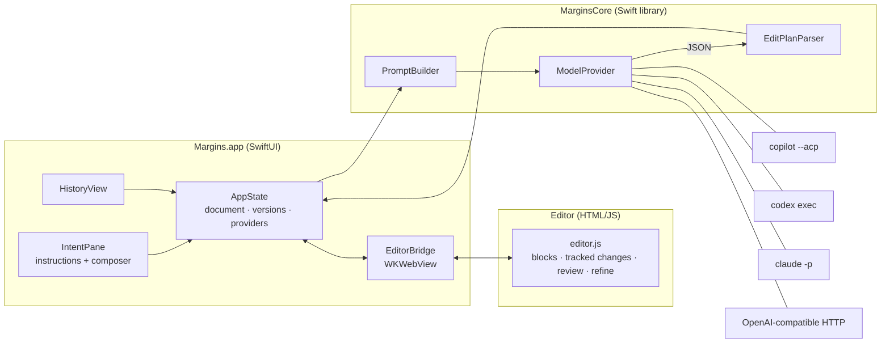

# 4. Architecture



## Package layout

| Target | What |
|---|---|
| `MarginsCore` | UI-free library: `EditPlan` + schema + tolerant parser, `PromptBuilder`, the document model (`MarginsDocument`, `Intent`, `Version`), and all providers. |
| `Margins` | The SwiftUI app plus the `Resources/Editor` web editor. |
| `MarginsCLI` (`margins-cli`) | Command-line access to the providers: `models`, `edit`. Handy for checking providers without the GUI. |
| `MarginsSelfTest` | Self-test executable for the core logic (stands in for XCTest when only the Command Line Tools are installed). |

## The block model

The document is HTML. Every **top-level block** (`p`, `h1–h3`, `ul`, `ol`, `blockquote`, `pre`, `table`…) carries a stable id, `data-bid="bN"`. The agent sees the document as a list of `{id, html}` blocks plus the ids of any blocks the user has selected (`focus`), and answers with block-level edits. Block granularity keeps the agent's output small and makes it easy to apply edits and show them as tracked changes. Finer, word-level diffing *inside* a replaced block is on the roadmap.

## Tracked changes in the DOM

A pending change is a wrapper element:

```html
<div class="chg" data-cid="c7" data-step="3" data-bid="b4" data-kind="replace">
  <del contenteditable="false"><p data-bid="b4">old text…</p></del>
  <ins><p>new text…</p></ins>
  <span class="tools">✓ ✕ 💬</span>
</div>
```

- **Accept** unwraps `<ins>` (its first block inherits the original `data-bid`) and drops `<del>`. **Reject** does the reverse.
- If a later instruction edits a block that already has a pending change, the `<ins>` is updated, but the original `<del>` is kept, so rejecting still restores what you actually had.
- The first draft of an empty document is applied directly, with no tracked changes.
- `normalize()` keeps the DOM honest after user edits: it wraps stray text in `<p>`, turns `contenteditable` `<div>`s into `<p>`, and de-duplicates ids cloned by pressing Enter.

## Swift ⇄ editor bridge

`EditorBridge` loads `editor.html` from the bundled resources and talks to `window.margins`:

| Swift → JS | JS → Swift (`webkit.messageHandlers.margins`) |
|---|---|
| `load(html)`, `html()`, `getBlocks()` | `ready` |
| `applyEdits(step, edits, direct)` | `pending {total, byStep, selected}` |
| `accept/reject({all\|step\|selected\|cid})` | `edited {sections, html}` (debounced, user typing) |
| `refineContext(cid)`, `applyRefinement(cid, html, n)` | `reviewed {accepted, rejected, sections, html}` |
| `highlightStep`, `revealStep`, `preview`, `endPreview` | `refine {cid, step, instruction}` |

## Flow of one instruction

1. The composer submits; `AppState` appends an `Intent` (status *working*).
2. `editor.getBlocks()` → blocks + focus; `PromptBuilder.editPrompt` builds the prompt.
3. The active `ModelProvider` returns text; `EditPlanParser` extracts the plan, with one retry on invalid JSON.
4. `editor.applyEdits(step, edits, direct: isEmptyDoc)` renders the changes; the intent gets its summary/notes and status *N pending* or *applied*.
5. A `Version` (author *agent*, slug from the plan) is snapshotted, and the document autosaves.
6. Review or user edits produce further versions (author *review* / *you*) with generated slugs.

## File format

`*.margins` is JSON:

```json
{ "format": 1, "html": "…", "nextStep": 4,
  "intents":  [{ "id": "…", "step": 1, "kind": "instruction", "text": "…", "status": "done", "summary": "…",
                 "notes": [], "provider": "GitHub Copilot", "refinements": 0, "createdAt": "…" }],
  "versions": [{ "id": "…", "number": 1, "slug": "draft rate limiting design note", "author": "agent",
                 "detail": "<instruction>", "html": "…", "createdAt": "…" }] }
```

Pending changes are saved as part of `html`, so you can quit mid-review and pick it up later.

## Packaging

`scripts/build-app.sh` runs a release `swift build`, assembles `Margins.app` (binary, the SwiftPM resource bundle under `Contents/Resources`, and an `Info.plist` declaring the `.margins` document type), and ad-hoc code-signs it. `EditorBridge` locates the resource bundle explicitly instead of using `Bundle.module`, which expects it at the `.app` root and would break code signing.
